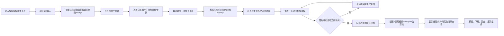
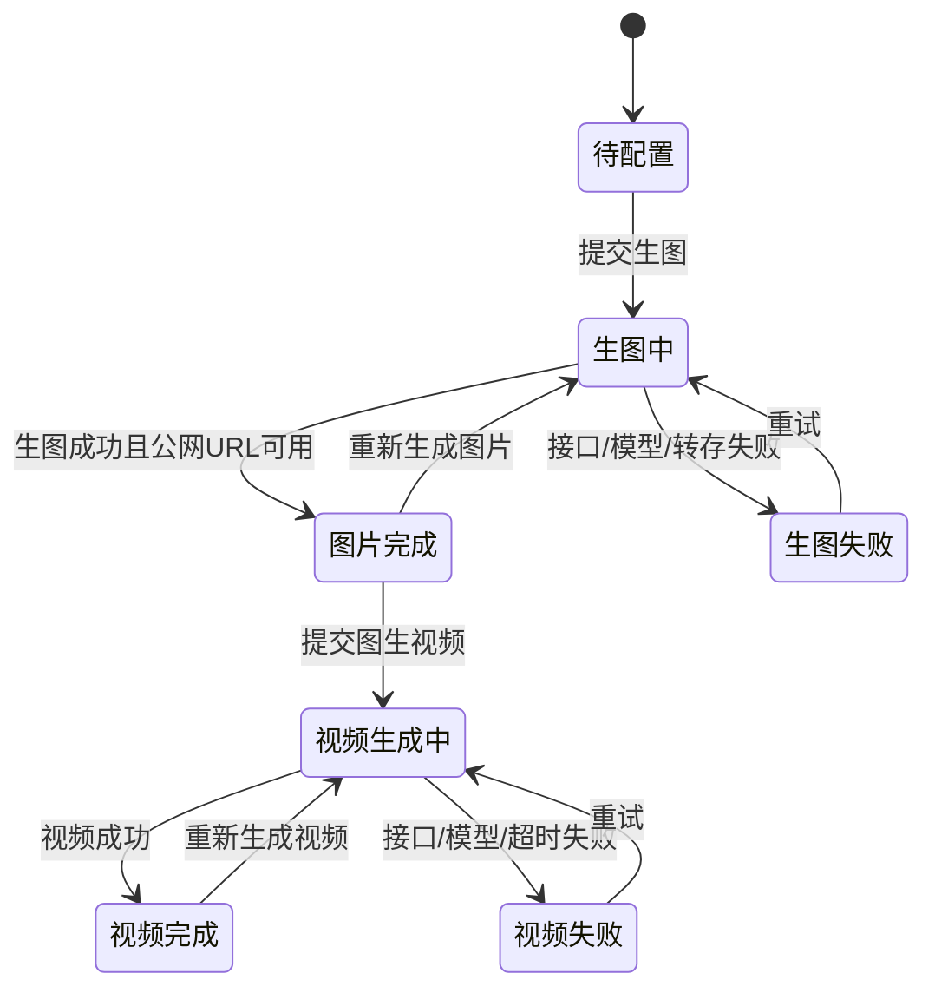

# 分镜工作台竞品链路与功能规格

> 研究日期：2026-08-13  
> 目标：一比一复刻对标的使用步骤与必需工具，不照搬品牌、价格和无关业务  
> 本文是后续替换现有“10秒故事工作台”的开发与验收基线

## 0. 产品边界

整个产品由两个已有体系协作，不应再造第三套流程。

### A. 故事版智能体卡片

- 位于主站现有“智能体应用广场”。
- 后台沿用现有新增/编辑智能体能力。
- 系统提示词在后台完整可见、可编辑、可持续升级，不硬编码在前端。
- 用户输入已经分段的文案、比例、风格、角色设定和特殊要求。
- 智能体输出每段对应的故事板生图 Prompt 与整合图生视频 Prompt。
- 它只生产 Prompt，不直接生成图片和视频，不需要独立页面。

### B. 分镜工作台

- 位于主站分类导航中的独立入口。
- 用户把智能体输出的两段 Prompt 粘贴到同一张镜头卡片。
- 在卡片内先生成一张四至五格故事板；成功后，同卡片解锁图生视频。
- 工作台负责模型、参数、任务状态、结果预览、下载、历史和重试，不负责再次拆文案或改写 Prompt。

### C. 明确不做

- 不把故事版智能体做成独立工作台页面。
- 不把聊天回复解析成自由画布节点。
- 不要求用户把四至五格分别裁图、上传或生成四至五次视频。
- 不在本阶段增加自动配音、字幕合成和最终剪辑。
- 不复用当前自由画布的角色图、参考图、视频节点链路。

## 1. 对标完整用户链路



操作次数的核心体验是：**一张卡片粘贴两次、点击生图一次、点击视频一次。**

## 2. 智能体卡片输入合同

对标两个故事版智能体使用相同的五项问题模板：

| 顺序 | 字段 | 类型 | 产品要求 |
| --- | --- | --- | --- |
| 1 | 分段文案 | 多行文本 | 接收 `1.【...】 2.【...】` 等已编号段落；不得再次拆段或合并 |
| 2 | 生图比例 | 单选 | `16:9`、`9:16` |
| 3 | 画面风格 | 文本 | 例如高品质院线级 3D 动画电影风格 |
| 4 | 角色设定 | 文本 | 具体人物、宠物、服装、毛色、年龄、体型；允许由智能体根据文案补齐缺省项 |
| 5 | 特殊要求 | 文本 | 例如指定金毛、真实产品参考图、禁用文字、特定场景等 |

这五项应由主站现有智能体卡片系统呈现，不在分镜工作台重复询问。

## 3. 工作台信息架构

### 3.1 顶部导航与标题区

应包含：

- 页面名称“分镜工作台”；
- 生成结果保留时长提示；
- “添加镜头”命令；
- “清理空闲卡片”命令；
- 当前图片模型和视频模型摘要；
- 返回主站的既有导航。

对标显示约 72 小时结果保留提示；我方应读取自己的系统配置，不能把该数字写死。

### 3.2 左侧模型栏

分为两组：

1. 图片模型列表；
2. 支持图生视频的视频模型列表。

每项至少展示：模型名称、计费信息、可用/会员状态、选中状态。锁定模型不可误触提交，模型切换只影响当前工作台的全局默认值。

### 3.3 全局参数工具栏

图片参数：

- 画面比例：模型支持范围内选择，常见 `1:1 / 16:9 / 9:16 / 4:3 / 3:4`；
- 图片分辨率：按模型支持 `512 / 1K / 2K / 4K`。

视频参数：

- 横竖屏分辨率：按模型支持 `720p / 1080p` 等；
- 目标时长：固定时长模型直接显示，或在 `5秒 / 10秒` 等支持值中选择；
- 质量档位：按模型支持展示。

参数的真实可选项必须来自模型能力和价格配置，不允许前端展示模型不支持的值。

### 3.4 镜头卡片网格

- 桌面端使用三列工作网格，随视口宽度响应式降为两列或一列。
- 默认可创建三张空卡，便于开始工作。
- 对标前端限制最多 20 张镜头卡片。
- 每张卡片是独立任务单元，但共用顶部模型和参数默认值。
- 卡片顺序就是分段/镜头顺序，编号必须稳定。

## 4. 单张镜头卡片完整规格

### 4.1 卡片头部

展示：

- `镜头 #N`；
- 当前状态；
- 预计图片费用；
- 预计视频费用；
- 删除按钮；
- 必要时显示任务编号或记录入口。

删除运行中任务必须禁止或二次确认，不能造成后台任务失联。

### 4.2 Prompt 输入区

同一卡片保留两个独立输入框：

1. **分镜生图 Prompt（必填）**；
2. **图生视频 Prompt（推荐必填）**。

对标技术上允许视频 Prompt 为空并回退使用图片 Prompt；我方可以保留此兼容，但故事版智能体正常输出时必须填写专用视频 Prompt。界面不能把两个 Prompt 合并成一个框，也不能自动用 AI 改写后再提交。

### 4.3 参考图输入

- 可选，不是故事板工作流的强制步骤；
- 支持本地上传和公网 URL；
- 对标每张卡最多五张参考图；
- 上传后可预览、删除、替换；
- 用于真实产品、强角色锁定或指定环境，不要求用户上传刚生成的故事板。

安全要求：视频阶段只能提交已转存的公网 `http/https` 图片 URL，不能把浏览器本地路径直接传给模型。

### 4.4 生图区

空闲状态：

- 显示“生成图片”按钮；
- 缺少必填 Prompt 时给出明确校验，不发请求。

运行状态：

- 显示进度或加载状态；
- 禁止重复提交；
- 保留卡片 Prompt 和参考图，不因页面重绘丢失。

成功状态：

- 显示完整故事板预览；
- 提供查看原图、下载和历史记录；
- 提供“重新生成图片”；
- 解锁下方视频区。

失败状态：

- 显示后端返回的根因，不用统一“生成失败”覆盖；
- 提供重试；
- 保留用户输入；
- 网络中断后可从任务记录恢复最终状态。

### 4.5 视频区

图片未成功时：

- 清楚显示锁定原因；
- 不允许提交视频。

图片成功后：

- 显示将使用当前故事板进行图生视频；
- 提供“生成视频”按钮；
- 整张故事板图片只作为一个上游图像地址提交；
- 视频 Prompt 整体提交，不按 Frame 拆成多个任务。

运行状态：

- 展示进度、排队或处理状态；
- 告知用户可稍后在生成记录查看；
- 页面刷新后能恢复任务状态。

成功状态：

- 内嵌视频播放；
- 查看、下载、重新生成；
- 显示任务记录与必要元数据。

失败状态：

- 显示服务端真实错误和可重试动作；
- 若根因是故事板 URL 不可公开读取，应明确提示转存失败，而不是让用户重新上传同一图片。

## 5. 卡片状态机



建议页面状态标签沿用对标清晰口径：

- 待配置
- 生图中
- 图片完成
- 生图失败
- 视频生成中
- 视频完成
- 视频失败

“进度条一直跑”必须由任务超时、断线恢复和后端终态共同兜底，不能仅靠前端定时动画。

## 6. 数据与接口合同

### 6.1 生图请求

```json
{
  "modelId": "图片模型ID",
  "prompt": "完整故事板生图Prompt",
  "imageUrls": ["可选参考图公网URL"],
  "aspectRatio": "16:9",
  "resolution": "1K"
}
```

返回至少应包含：

- 任务 ID；
- 当前状态；
- 最终故事板公网 URL；
- 失败原因；
- 费用与时间信息。

### 6.2 视频请求

```json
{
  "modelId": "视频模型ID",
  "prompt": "对应Frame 1至Frame N的整合图生视频Prompt",
  "imageUrls": ["本卡片刚生成的故事板公网URL"],
  "firstFrameUrl": "",
  "lastFrameUrl": "",
  "resolution": "1080p",
  "duration": 10,
  "quality": "模型支持档位"
}
```

关键合同：

- `imageUrls` 只有整张故事板，不自动裁格。
- 视频 Prompt 是一个字符串，不由前端二次 AI 组装。
- 前端不把本地路径、Blob URL 或临时不可公网访问地址提交给模型。

## 7. 历史记录与恢复

每次生成必须产生可恢复记录，至少保存：

- 工作台运行编号；
- 卡片顺序与镜头编号；
- 两段原始 Prompt；
- 参考图地址；
- 模型和参数；
- 图片/视频任务 ID；
- 结果 URL；
- 状态、错误、创建与完成时间；
- 费用信息。

恢复工作台时，应按原顺序重建卡片和结果，不要求用户依赖浏览器当前页一直打开。

“清理空闲卡片”只能删除无结果、无运行任务的空卡；不得清除已生成或正在运行的卡片。对标前端也采用这一保护逻辑。

## 8. 一比一复刻验收矩阵

| 编号 | 用户动作 | 预期结果 |
| --- | --- | --- |
| W01 | 从智能体复制一个分段的两段 Prompt | 无需手动改格式即可粘贴工作台 |
| W02 | 新建镜头卡并粘贴两个 Prompt | 两个字段独立保存，刷新后不丢 |
| W03 | 选择图片模型、比例和分辨率 | 可选项与模型能力一致 |
| W04 | 可选上传 1 至 5 张参考图 | 预览、删除、替换正常，提交为公网 URL |
| W05 | 点击生成图片 | 只提交一次，状态从待配置进入生图中 |
| W06 | 生图成功 | 显示一张完整多格图、查看和下载，并解锁视频 |
| W07 | 生图失败 | 显示真实错误，Prompt 与参考图保留，可重试 |
| W08 | 点击生成视频 | 整张故事板 + 整段视频 Prompt 一次提交 |
| W09 | 视频处理中刷新页面 | 重新进入仍能恢复真实进度或终态 |
| W10 | 视频成功 | 卡片内播放、下载、历史和重新生成均可用 |
| W11 | 添加多张镜头卡 | 编号稳定，最多 20 张，任务互不串卡 |
| W12 | 清理空闲卡片 | 只删除空闲空卡，不影响结果和运行任务 |
| W13 | 打开生成记录 | 能恢复卡片顺序、Prompt、参数、图片和视频 |
| W14 | 视频模型拒绝故事板 URL | 明确显示 URL/转存根因，不提示用户盲目重传 |
| W15 | 移动端或窄屏查看 | 卡片降列且文本、按钮、媒体不重叠 |

## 9. 与现有错误方向的差异

| 现有错误假设 | 正确方案 |
| --- | --- |
| 为故事版智能体单独做一个页面 | 使用主站现有智能体卡片和后台编辑能力 |
| 工作台接收原始文案并自动拆解 | 工作台只接收智能体已经输出的两段 Prompt |
| 一段文案产生多张独立图片 | 一段文案只生成一张四至五格故事板 |
| 每格分别生成视频或由前端组装 | 整张故事板和整段视频 Prompt 一次提交 |
| 视频阶段要求用户再次上传参考图 | 直接使用本卡片刚生成并转存的故事板 URL |
| 继续依赖自由画布节点 | 新工作台是独立、密集、可批量操作的卡片工具 |
| 只做相似外观 | 按模型、参数、状态、历史、重试和下载逐项复刻行为 |

## 10. 开发顺序

1. 完成参考图与视频协同研究报告。
2. 根据报告重写故事版智能体系统提示词和固定聊天输出格式。
3. 在主站后台新增/更新“故事版智能体”卡片，确保提示词可见可编辑。
4. 用现有模型和任务接口替换 `/storyboard-workbench`，先完成单卡完整链路。
5. 补齐多卡、状态恢复、历史记录、失败重试、下载和清理空卡。
6. 使用真实已分段口播做端到端验收：智能体输出 → 复制 → 生图 → 图生视频 → 下载 → 历史恢复。
7. 只有结果和对标链路逐项一致后，才进入发布阶段。

本文档是开发门禁。任何与上述产品边界、单卡双阶段或整图一次提交相冲突的设计，应先停下并重新评审。
